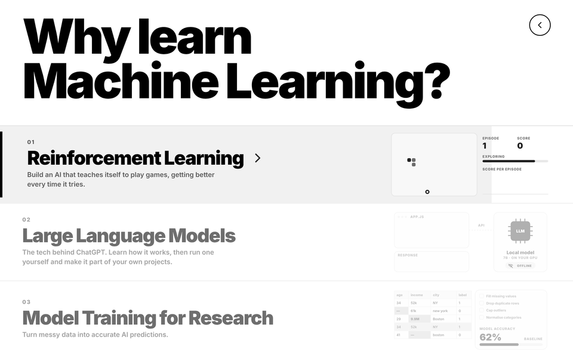
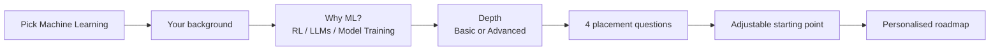
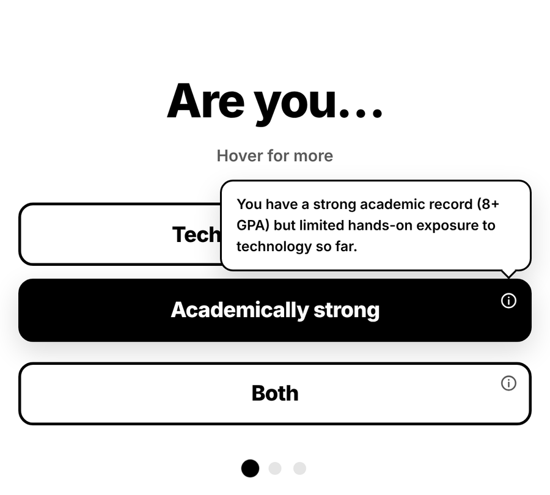
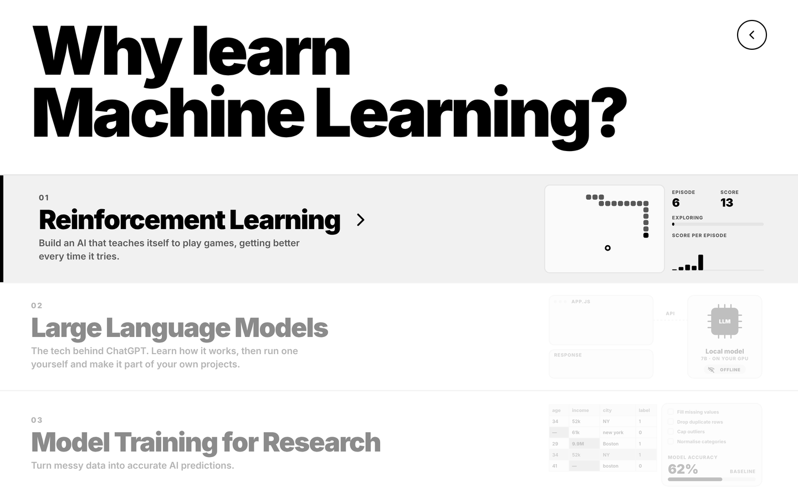
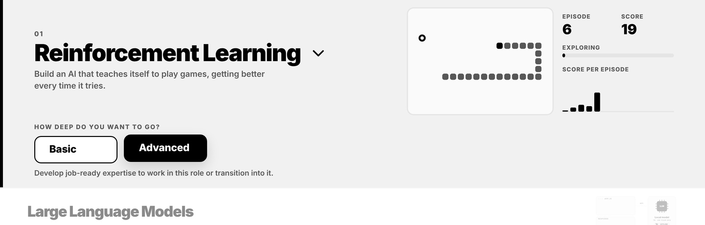
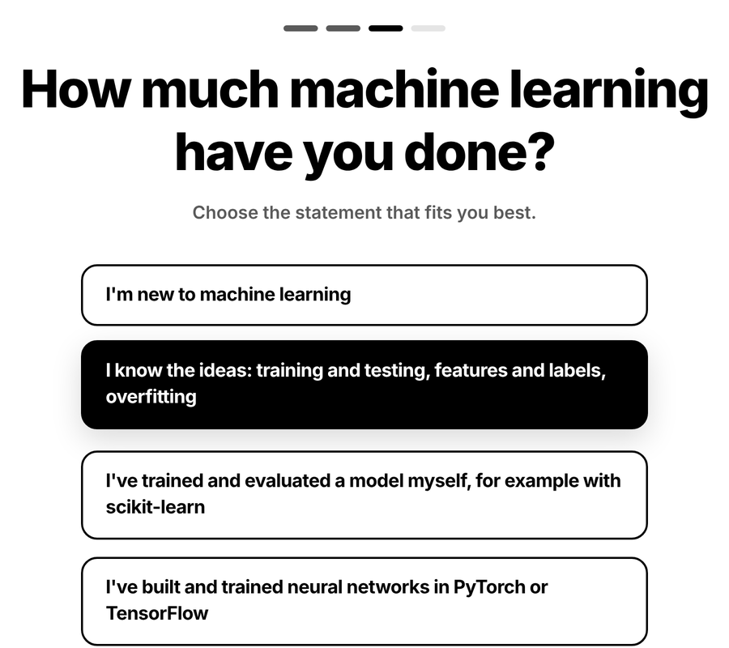
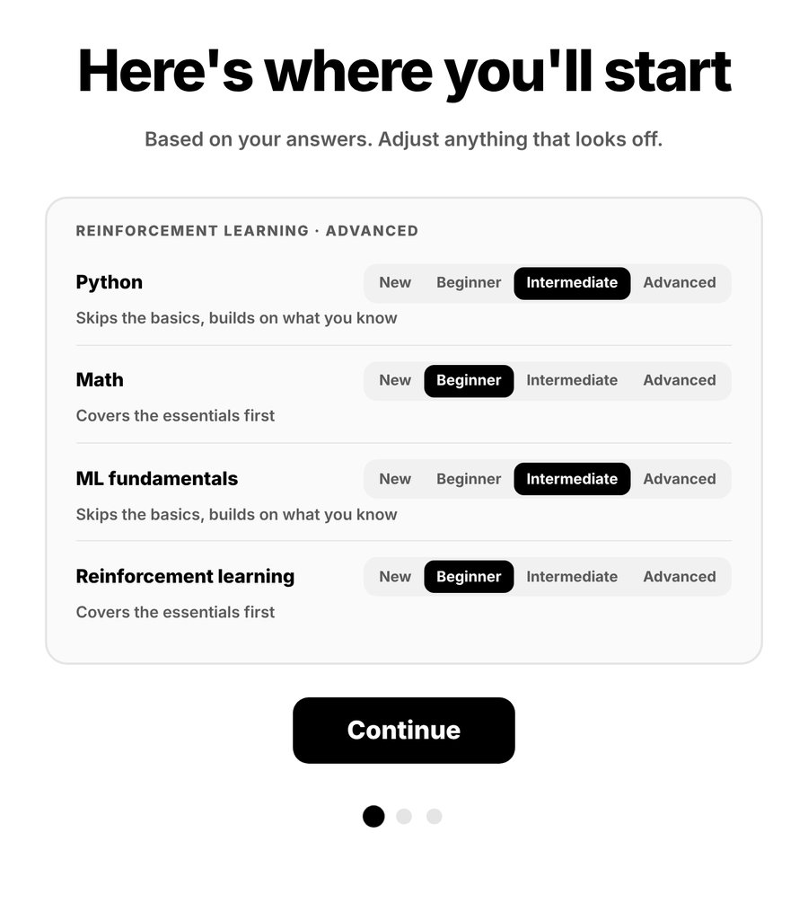
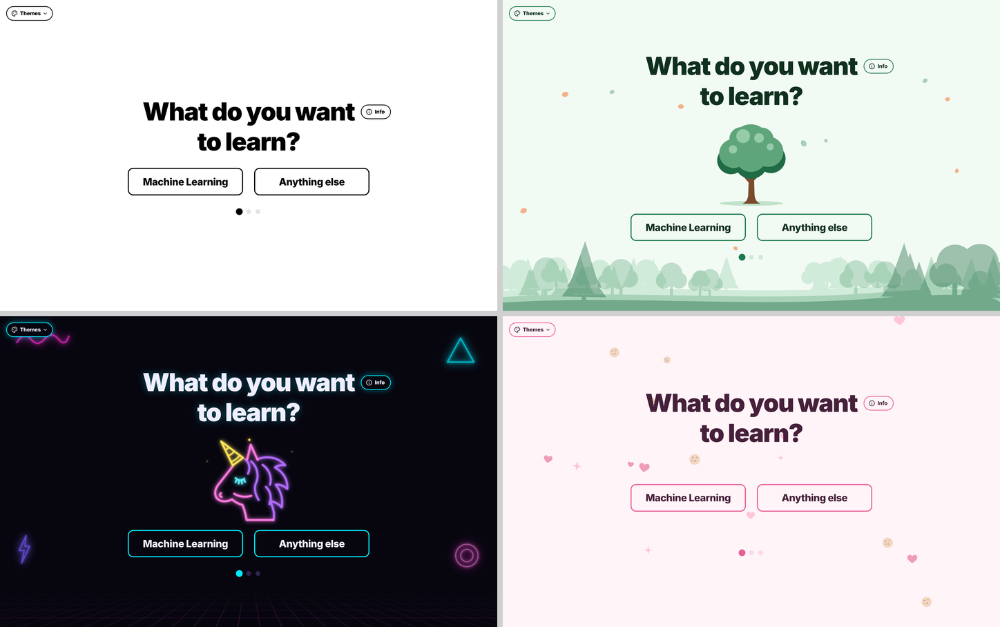

# RoadMapper

**Tell it what you want to learn. It works out where you stand and builds a step-by-step learning roadmap, with videos from channels that have been vetted by hand.**

This repository is a showcase of the interface and how it works. The source code is private and available on request.

  

---

## The Machine Learning track

Most roadmap generators ask "beginner, intermediate or advanced?" and guess from there. RoadMapper's Machine Learning track asks three short, concrete things instead: who you are, why you want ML, and what you can already do. Only then does it build the roadmap.

### 1. Your background

Three options, each with a short explanation that shows on hover, or on tap (the ⓘ button) on phones.

### 2. Why learn Machine Learning?

Each goal shows a small live scene while you hover it, so you can see what the field actually does before committing:

| Goal | What the scene shows |
|---|---|
| **Reinforcement Learning** | A snake agent that teaches itself. It explores at random at first, then improves episode by episode, with a live score-per-episode chart and an exploration meter. |
| **Large Language Models** | An app sending a prompt to a model running locally on your own GPU, offline, and getting a response back. |
| **Model Training for Research** | Messy data being cleaned step by step while the model's accuracy rises from its baseline. |

Choosing a goal opens a drawer to pick how deep to go. **Basic** gives a solid working understanding of the field. **Advanced** builds job-ready expertise for working in the role or moving into it.

### 3. Placement: what can you already do?

Four questions cover Python, the math behind ML, ML fundamentals and your chosen field. Every answer is a **concrete statement, not a self-rating**. People judge *"I've trained and evaluated a model with scikit-learn"* far more accurately than *"intermediate"*.

<table>
  <tr>
    <td width="50%"></td>
    <td width="50%"></td>
  </tr>
  <tr>
    <td align="center">One question per screen, with progress pips</td>
    <td align="center">The summary shows what each level means, and you can adjust any of them</td>
  </tr>
</table>

Each level changes how the roadmap treats that area:

| Level | Effect on the roadmap |
|---|---|
| New | Starts from the very beginning |
| Beginner | Covers the essentials first |
| Intermediate | Skips the basics, builds on what you know |
| Advanced | Assumed, so the roadmap goes straight past it |

---

## Trusted video sources

Searching YouTube for a topic tends to surface whatever is most popular, not what teaches best. RoadMapper ranks video results with a **trusted-channel catalog**:

- **100 topics** with **1,431 hand-researched channel entries**, each checked against the live YouTube Data API.
- **Channels scored per topic**, with a short note on why each one was picked and the levels it suits.
- **Reviewer pins** keep channels whose teaching was checked by hand at the top of their topic, even when the score alone would rank them lower.
- **Vetted channels get a boost**, but a strong on-topic result from elsewhere can still win.

If a topic isn't in the catalog, the app falls back to a normal YouTube search.

## Themes

Four complete visual themes, each with its own animated intro on the start screen:
- **Minimalist:** click the button
- **Forest:** tap the tree
- **Neon:** tap the unicorn
- **Baby:** tap the donut

## Under the hood

| Part | Built with |
|---|---|
| Interface | Plain HTML, CSS and JavaScript, with no framework and no build step |
| Roadmap generation | Google Gemini, with tool calls for web search (Tavily) and YouTube search |
| Video ranking | Trusted-channel catalog built and verified against the YouTube Data API v3 |
| Server | Small Node.js server with no dependencies. It serves the app and keeps all API keys on the server, so they never reach the browser. It also tracks the daily YouTube API quota. |
| Accessibility | Keyboard navigation, visible focus, ARIA labels, touch-friendly tips, reduced-motion support |

Besides the Machine Learning track, the start screen offers **Anything else**, where you type any topic and get a roadmap for it.

---

**Source code:** private. If you'd like to see it for a role or collaboration, open an issue on this repository or contact me through my GitHub profile.
